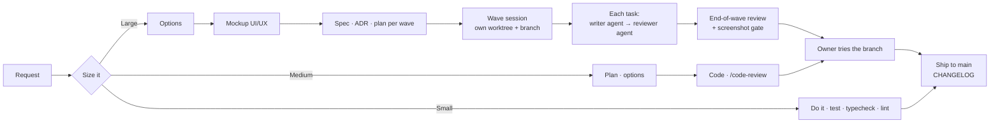

# dev-workflow

**A Claude Code plugin that turns "AI writes most of the code" into a process a human can trust:** size every request, design before code, split features into waves, give every task one writer agent and one reviewer agent, and keep the human as the only one who approves the gates.

[](LICENSE)  

It was extracted from building and running [OpenER](https://opener.com.vn), a Vietnamese open-courseware platform (Next.js, TypeScript, Supabase/PostgreSQL), solo with Claude Code. Every rule in it exists because skipping it once cost time, tokens or a broken release.

## The problem it solves

When an AI agent writes most of the code, the risk moves from typing to judgement: a wrong plan, a skipped review, a UI nobody looked at on a phone, a migration run by accident, a context window full of noise. This plugin puts guard rails at exactly those points and leaves the rest fast.

## Track record (OpenER, November 2026)

| | |
| --- | --- |
| Product | Live at [opener.com.vn](https://opener.com.vn), launched 18 Nov 2026 |
| Design specs / plans / architecture decisions | 68 / 79 / 55 |
| Branches merged to main, each with a CHANGELOG entry | 118 |
| Database migrations (PostgreSQL with Row Level Security) | 202 |
| Unit test files | 600+ |

## How a feature runs



The owner holds four gates: **pick an option, approve the mockup, try the branch, say "ship to main"**.

## Six ideas behind it

| Idea | Why |
| --- | --- |
| **Size first** (Large / Medium / Small) in the first reply, never lowered mid-way | Thinking is spent where a mistake is expensive (requirements, design, spec), not on typos. |
| **Design before code**: options → mockup (UI/UX) → spec → plan for one wave only | A wrong plan costs a rewrite; a wrong line costs a fix. |
| **Waves and fresh sessions**: one worktree, one branch and one progress log per wave | Progress lives in files (`progress.md`), not in the model's memory. |
| **One writer, one reviewer** per task; model chosen by the cost of a mistake | Cheap model for copy tasks, strongest model for data loss, access rules and migrations; reviews catch what writers miss. |
| **Screenshot gate**: UI is done only after real pages are captured at 375 and 1280 px, light and dark, with the heaviest real content | Overflowing tables on phones ship when nobody looks. |
| **Token budget**: docs loaded every session stay under ~3 KB; read by headings and line ranges; hand wide scans to cheaper agents | Every turn re-reads the whole context. |

## What you get

| Piece | What it does |
| --- | --- |
| `/dev-workflow:init-workflow` | Sets up a project: a process snippet in `CLAUDE.md` (≤ 2.5 KB), a `docs/00–09` layout, `CHANGELOG.md`, a progress-log template and, optionally, UI templates (screen inventory, UX checklist) and a doc-size check script. Asks before writing, never overwrites a file. |
| `workflow` skill | The full process: sizes, steps, sessions, model choice, review, screenshot gate, token savings, parallel work. Seven reference files load only when needed, so it costs almost nothing per session. Also callable as `/dev-workflow:workflow`. |

```
skills/
├── init-workflow/          # sets up a project
│   ├── SKILL.md
│   └── templates/          # CLAUDE snippet, CHANGELOG, progress log, screen inventory,
│                           # UX checklist, UI rules, docs index, check-doc-size.mjs
└── workflow/               # the process, loaded on demand
    ├── SKILL.md
    └── references/         # large-work · sessions · model-choice · review ·
                            # ui-gate · token-saving · parallel-work
```

## Install

In Claude Code:

```
/plugin marketplace add Tay-Tran/claude-dev-workflow
/plugin install dev-workflow@dev-workflow-marketplace
```

Then, in each project:

```
/dev-workflow:init-workflow
```

Update with `/plugin` → Marketplaces → Update, or `claude plugin update dev-workflow@dev-workflow-marketplace`.

**Requirements:** Claude Code with plugin support and the **superpowers** plugin (installed as a dependency). Optional: `/code-review` for end-of-wave review, Playwright with real Chrome for UI screenshots.

## Customising

The snippet in your `CLAUDE.md` sits between `<!-- dev-workflow:start -->` and `<!-- dev-workflow:end -->`. It is yours after setup: edit it freely, but keep it under 2.5 KB because it loads in every session.

## Tóm tắt tiếng Việt

Plugin Claude Code đóng gói quy trình làm phần mềm cùng AI agent, rút ra từ quá trình tự xây dựng và vận hành [OpenER](https://opener.com.vn). Claude xếp cỡ mọi yêu cầu ở câu trả lời đầu; việc lớn đi qua phương án → mockup giao diện → spec → kế hoạch theo đợt, chủ dự án duyệt từng cổng; mỗi đợt một worktree và nhánh riêng, mỗi task một agent viết và một agent soát; giao diện chỉ xong khi đã chụp trang thật. Cài bằng hai lệnh `/plugin` ở trên.

## Author

Trần Ngọc Tây — full-stack developer (TypeScript, PostgreSQL, Next.js). [GitHub](https://github.com/Tay-Tran) · [OpenER](https://opener.com.vn)

## License

MIT
